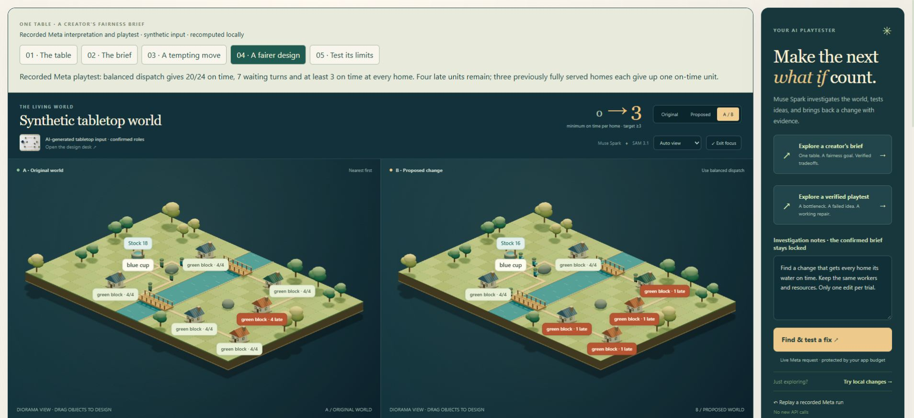
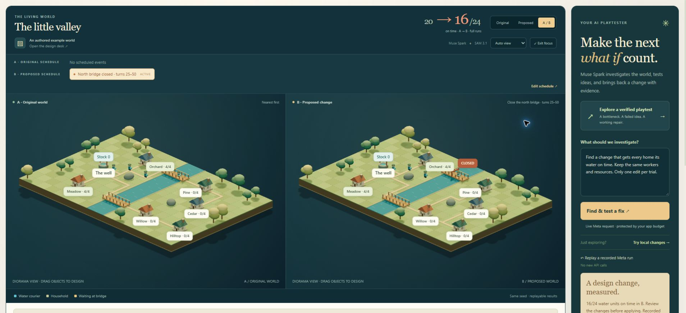

# LiveWorld

**Build a world on your desk. Find what breaks. Test the fix.**

LiveWorld is a tabletop playtest studio for small logistics games. Turn objects and design intent into a playable system, see what breaks, and compare a measured repair. Muse Spark interprets supported rules and investigates experiments; SAM segments the objects; the simulator checks what actually happens.

Built by Tang Vu for the Meta Global AI Developer Hackathon 2026, Indie Developer track.



**[Watch the three-minute demo](public/demo/liveworld-demo.mp4)** · [Recording details and transcript](demo/README.md) · [Submission draft](docs/submission.md)

## Run locally

Requires Node.js 24 or later. No server GPU or external database is required.

```sh
npm install
npm start
```

Open **http://127.0.0.1:4173**. The included example worlds, replay, dragging, and **Try local changes** work without a key and make no model calls.

On Windows, you can also double-click **`start-liveworld.cmd`**. It checks Node and configuration, installs missing dependencies, then starts the local backend. It does not replace an existing `.env.local`. Open **http://127.0.0.1:4173/demo/** for the bundled video player.

To enable Meta, copy `.env.example` to `.env.local` and set `MODEL_API_KEY`. On Windows PowerShell:

```powershell
Copy-Item .env.example .env.local
npm.cmd start
```

If a configured `.env.local` already exists, preserve it rather than copying over it. Restart the server after changing environment settings. The key is read only by the local backend. Never put it in browser code or commit it.

## Try the first experiment

The three-minute film uses this path.

1. Choose **Explore a creator's brief**. The recorded Meta study loads locally and makes no new API calls.
2. Step through the table, the confirmed brief (at least 20/24 on time, at least 3 at every home, at most 10 waiting turns), and the tempting stick move. Waiting falls from 22 to 10, and four late units move to another home, so the brief fails.
3. Open **A fairer design**. Balanced dispatch meets the brief: 20/24 on time, 7 waiting turns, and at least 3 at every home. Four units remain late. Three homes that were fully on time each give up one unit.
4. On **Delivery receipts**, select a home and an arrival. Both worlds jump to that turn and the courier is highlighted.
5. On **Test its limits**, the lower bridge shifts one cell in both worlds. One side breaks the waiting cap. The other breaks the on-time floor.

**The little valley** is the world the studio opens on, and it is a different example from the film. Baseline nearest dispatch is 20/24 on time with 16 waiting turns. Balanced dispatch there is a failed proposal at 14/24. Moving the south bridge to zero-based row 6 reaches 24/24 and raises waiting to 22. Do not mix that 24/24 result with the synthetic tabletop.

Play or scrub a replay and select a home to highlight its route. **Try local changes** runs a labelled deterministic search without API usage. **Find & test a fix** makes a live Muse Spark request. **Use B as my world** continues from a candidate and keeps A as a checkpoint.

**Explore a verified playtest** walks through the valley recording: the original bottleneck, a plausible failed hypothesis, and a verified repair. **Write a game rule → Explore a recorded rule experiment** loads a timed bridge closure compiled by Meta. Neither walkthrough makes new API calls. Their recording labels stay visible.

**Focus** gives the world more room for a presentation or detailed inspection; press Escape to leave it. The orthographic 3D scene uses the same ground projection as labels and object picking. Buildings, trees, materials and lighting are procedural project assets, rendered with Three.js. A canvas renderer remains available when WebGL is unavailable. Landscape decoration does not change simulation obstacles or routes. Ambient water movement leaves the simulation turn unchanged, and reduced-motion preferences disable ambient animation and initial autoplay.

## Design against a creator brief

Choose **Set the test brief** to define success before testing: a total on-time minimum, an optional minimum for every home, a maximum number of courier waiting turns, and which existing bridges or dispatch policy may change. Muse Spark can translate the instruction into a proposal; inspect the fields and confirm them. Manual entry makes no model calls. Each repair still permits only one edit, with resources, demand, deadlines and schedule locked.

Blank total means all demand must arrive on time; enter zero to remove that total minimum. Blank per-home floor or waiting cap adds no such condition. The engine evaluates each confirmed condition independently of model prose. The brief travels inside the world through projects, checkpoints, reports and replay inputs. Imported pass flags are discarded. Older worlds without a brief retain their original all-on-time objective.

**Explore a creator's brief** is a recorded Meta study on one synthetic tabletop world. Its brief requires at least 20/24 units on time, at least three at every home, and at most ten waiting turns. The original has 20/24 on time and 22 waiting turns, with one home receiving no on-time units. Moving the lower stick cuts waiting to ten, but transfers four late units to a different home; it fails the per-home floor. A recorded Meta playtest selects balanced dispatch: **20/24 on time, seven waiting turns, and at least three on time at every home**. Four units remain late; three previously fully served homes each lose one on-time unit. This is an authored showcase on previously observed inputs, not a held-out benchmark or a real-camera evaluation.

The **Delivery receipts** tab compares every household and links each completed delivery to its dispatch/arrival events, bridge visits and waiting frames. Selecting an arrival replays its exact turn and labels the relevant courier. A/B deliveries are matched by home and arrival order, not assumed to be the same parcel or courier. Outbound waiting excludes return trips, while the aggregate waiting metric includes both.

The **Stress test** tab applies the same declared perturbation to A and B: all deadlines shift −3…+3 turns, or one selected bridge shifts −1, 0, +1 cell. The confirmed brief stays fixed. Invalid conditions remain visible. Export retains both input worlds, the condition set and recomputed results. These finite conditions do not estimate a reliability percentage or prove anything beyond the selected set. In the creator study, shifting the lower bridge one cell in either direction breaks the balanced design's waiting cap or total on-time floor.

Replay the new evidence without API usage:

```sh
node scripts/evaluate-contracts.mjs
node scripts/record-creator-study.mjs
```

The eight [predeclared interpretation cases](demo/contract-evaluation-cases.json) matched their expected contracts or refusals in one attempt each, using eight Meta requests at an app-estimated $0.035343. They include named edit permissions, preservation of existing criteria, ambiguity, unsupported resource changes and a measurable but infeasible brief. This is a small integration check, not a general accuracy claim. The separate creator translation/playtest used five Meta requests and 22 simulated trials at an app-estimated $0.048361. `--live` explicitly makes new paid requests; the default commands only verify the saved outputs.

[Open the creator project](public/examples/creator-brief-project.json) · [Read its measured report](public/examples/creator-brief-report.html) · [Creator usability protocol](docs/creator-validation.md). No creator sessions or productivity measurements have been completed.

## Use your own table

Choose **Capture your table**, select a photo or capture a camera frame, and then select **Find objects**. This sends the resized image to Meta:

The capture dialog also offers **Load scene A** and **Load scene B**: AI-generated tabletop inputs, with the lower stick moved in B. Loading them makes no API calls; **Find objects** still runs the real Meta pipeline. Worlds created from those buttons are labelled **SYNTHETIC** and retain that provenance in their export. Prompts and limitations are recorded in [`generated-inputs.json`](public/examples/generated-inputs.json). They are not real camera captures, and generative edits are not guaranteed to preserve every pixel outside the moved object.

Both inputs were processed by the actual Muse Spark + SAM pipeline. The included post-fix UI exports preserve all 11 object identities: ten grid positions remain unchanged and one bridge moves from row 10 to row 7. Recompute the comparison without API usage with `node scripts/check-generated-pair.mjs`. The [recorded report](public/examples/generated-capture-check.json) includes the measured simulation outcomes; meeting every deadline is not claimed for this pair.


- **Muse Spark 1.3** proposes object locations and tentative source / house / bridge / obstacle roles using structured output.
- **SAM 3.1** segments the proposed objects using box prompts. Actual returned masks are drawn over the photo; missing masks are not presented as successful segmentations.
- You review the roles before building the world.

This prototype uses image-relative coordinates snapped to a fixed 18×12 grid with a predefined river. Bridge anchors map to the river, and overlapping objects move to nearby valid cells. Review those placements. This is not metric reconstruction or a physics model. Rescans match nearby objects of the same confirmed role heuristically and retain the previous grid cell under small detection jitter. The reference anchor stays fixed until sufficient movement accumulates. Inspect the result, especially after large moves or occlusion.

## Keep an experiment and design its rules

**Save project** downloads a portable JSON file containing the original world, its photo, up to 12 checkpoints, up to 32 trials and the selected comparison. **Open project** accepts that file or an older experiment export. Every trial is recomputed; success flags supplied in a file are not trusted. Imported activity is labelled as imported because a file cannot authenticate a provider call. Autosave retains the same project in this browser using IndexedDB. Download a project copy for a backup or another device.

**Evidence** exports the original experiment JSON or a standalone HTML report with A/B measurements, a change list and household results. The corresponding project file contains replayable inputs.

**Write a game rule** supports manual editing or a natural-language instruction compiled by Muse Spark into a constrained proposal. Supported settings are dispatch, couriers, bridge capacity, production interval, simulation horizon, household demand and deadlines. Two timed mechanics make the design executable:

- **Close an existing bridge** during an inclusive turn interval. New trips avoid it; approaching couriers reroute or wait; couriers already on it finish crossing.
- **Pause the well's production** during an inclusive interval. Existing water remains available and the original production clock is retained.

Up to six scheduled events are supported. Code validates targets, intervals and overlaps. The instruction and exact changes remain visible in B before application. Unsupported or ambiguous requests are reported without partially applying their other changes. These are discrete game mechanics, not physical flood or fluid simulation. Creator rule changes are distinct from constrained playtest repairs.



In the bundled closure study, on-time delivery changes from 20/24 to 16/24. A subsequent recorded Meta playtest improves it to 22/24 with the schedule locked; it remains **not solved**. Open the [design project](public/examples/closed-crossing-project.json) or [repair project](public/examples/closed-crossing-repairs-project.json) and recompute their outcomes with `node scripts/check-mechanics.mjs`.

A fresh photo world starts with the example game rules. Rescanning an existing photo world preserves its rules, matches nearby objects of the same role and opens as a comparison against A. Apply only after reviewing the changes. To inspect the recorded generated-image pair without making calls, choose **Capture your table → Replay recorded A/B capture**. This is explicitly a replay of saved Meta outputs, not a live camera demonstration.

## Agent and verification

Muse Spark can inspect baseline events and delivery receipts, call `test_change` for a hypothesis, and use `search_one_edit` to systematically search permitted bridge positions or dispatch policies. Each trial may change **one dispatch policy or move one existing bridge**. Couriers, production, households, demand, deadlines, and bridge capacity are locked during playtesting. The engine checks the confirmed brief; worlds without one default to delivering every unit by its household deadline. It does not compile arbitrary game mechanics.

The simulator independently computes paths, movement, bridge queues, water accounting, deliveries, deadlines, and the final verdict. A model's written claim cannot change the verified success flag. The best candidate means the best among evaluated candidates, not a globally optimal solution. An unsuccessful limited search is not proof of impossibility.

The agent uses at most 6 model turns and 32 distinct simulated candidates per run. A bounded search reports whether it covered its selected search space. Local simulation does not use API credits.

## Share a playable experiment

**Project → Export replay clip** renders a silent 1920×1080 WebM at 30 fps, using the studio's renderer and independently recomputed simulation frames. Choose an original, proposed or synchronized A/B view, a turn range and a 12, 20 or 30-second duration. Download the video and its replay inputs. Export makes no model calls and preserves the project.

This optional feature needs a browser with WebCodecs video encoding support, such as a recent Chromium browser. Rendering speed depends on the device; the file's frame timing is explicit, so slower export does not reduce its frame rate. Project JSON and HTML evidence exports remain available when video encoding is unavailable. Media packaging uses the unmodified, locally bundled Mediabunny library; see [third-party notices](THIRD_PARTY_NOTICES.md).

## Budget controls

- Project total: **$150**; initial cumulative development phase: **$10**; protected reserve: **$50**.
- Before each Spark call, the backend reserves the published cost of a full 1,048,576-token input context plus its capped output. It settles against reported token usage afterward, conservatively ignoring input-cache discounts.
- SAM image requests reserve the published per-image cost.
- The local ledger survives restarts and uses an exclusive lock for updates. Pending calls keep their reservations.
- There are no automatic model retries. Missing usage or uncertain transport failures pause further paid requests for review.
- The ledger counts calls made by this app. It does not know the Meta account balance or spending by another application. Pricing must be rechecked if models or provider prices change.

Local records are in ignored `.liveworld/`: `usage.json` contains reservations and usage receipts; `runs/` contains completed playtests. Do not delete the ledger to bypass a limit. Billing shown by Meta remains authoritative.

## Checks

```sh
npm test
npm run evaluate
npm run check:config
```

These commands make no paid requests. Tests cover deterministic replays, resource conservation, bridge capacity, disconnected worlds, impossible deadlines, patch constraints, independent verification, and budget failure cases.

Replay the bundled evidence without API usage:

```sh
node scripts/check-generated-pair.mjs
node scripts/check-mechanics.mjs
node scripts/evaluate-rules.mjs
node scripts/check-agent-evidence.mjs
```

The October 28 rule evaluation used six predeclared English instructions on renamed authored layouts, one attempt each. All six matched the expected semantics or refused the unsupported/ambiguous request, at an app-estimated cost of $0.028595. This small integration check is not a general accuracy benchmark. The [saved inputs and responses](public/examples/rule-evaluation.json) can be independently replayed; `--live` explicitly makes six new paid requests.

A separate [agent integration record](public/examples/agent-id-check.json) exercises non-default bridge IDs. It contains 22 trials through three Meta requests, verifies a 24/24-on-time candidate and retains a rejected proposal in the trace. This is one authored scenario, not a general success-rate claim.

`node scripts/smoke-meta.mjs` is a separate, explicitly paid one-request connectivity check, using the same budget gate.

`node scripts/check-playtest.mjs` is a separate, explicitly paid HTTP integration check against a running local backend. It runs the real Meta agent and independently replays every returned patch. The October 28 check evaluated 22 trials and verified a 24/24-on-time candidate through five Meta requests; that run's local cost estimate was $0.032478. This is one observed run, not a general success-rate claim.

`node scripts/check-local.mjs` checks a running local server, including private-file isolation and cross-origin request rejection, without paid API calls. `node scripts/check-scan.mjs` is an explicitly paid Spark + SAM integration check using an original synthetic test image, not a real camera evaluation.

## Repository map

- `shared/`: world validation, constrained patches, pathfinding, simulation, measurements.
- `src/`: Meta integration, agent loop, persistent budget ledger.
- `public/`: studio, canvas renderer, replay exporter, capture and role review.
- `server.mjs`: loopback-only HTTP backend. It does not serve environment files or private usage records.
- `tests/`: offline tests; no real API key required.
- `scripts/`: evaluation and configuration checks.

## Event scope and references

This repository was started during the hackathon on October 27, 2026. Its simulator, workbench, budget controls, and agent integration were developed for this project. It does not reuse Keryx code. Existing platform capabilities are Meta's models and the official `@meta-sam/parser` dependency; generated segmentation masks are model outputs.

Third-party media packaging code is identified in [THIRD_PARTY_NOTICES.md](THIRD_PARTY_NOTICES.md); it is not claimed as an original contribution.

The verification design was informed by Meta's [legal-agent workshop](https://github.com/meta-models/legal-agent-workshop), particularly checks outside agent control and replayable experiments. Workshop application code and legal-case assets are not copied here.

Technical references: [Meta tool calling](https://dev.meta.ai/docs/tool-calling), [structured output](https://dev.meta.ai/docs/structured-output), [SAM client libraries](https://dev.meta.ai/docs/sam/client-libraries), and [published pricing](https://dev.meta.ai/docs/pricing-rate-limits).

The requested delivery is local, with generated tabletop inputs and a three-minute demo. No public hosting or event submission has been performed. Optional hosting files are documented in [deploy/README.md](deploy/README.md); public mode requires a separate demo code, HTTPS and the existing persistent budget ledger. The Docker image was built and checked locally without a key or inference.

This remains a fixed-camera prototype. Real tabletop capture, latency, usability, and playtest performance need broader evaluation. No user study or general performance improvement is claimed.
