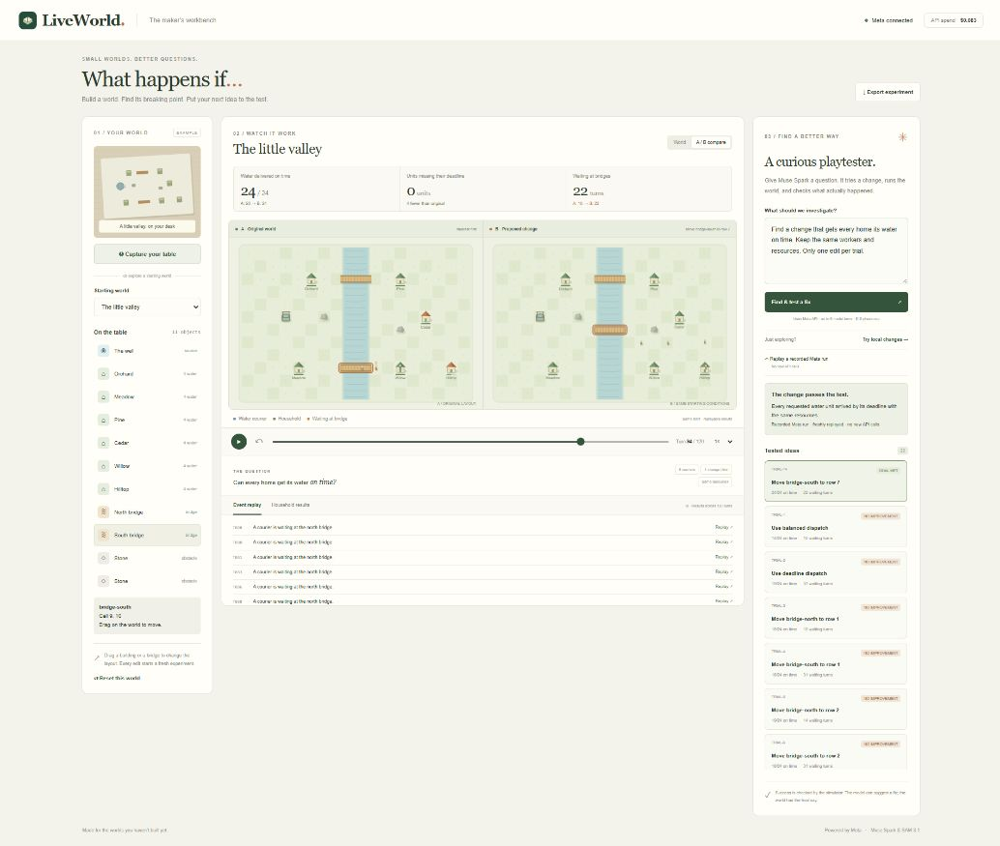
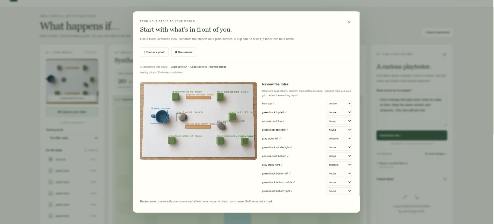

# LiveWorld

**Build a world on your desk. Find what breaks. Test the fix.**

LiveWorld is a tabletop prototyping and playtesting workbench for small logistics games. Arrange ordinary objects, confirm their roles, and turn them into a playable 2D world. Ask a Meta-powered agent to investigate missed deadlines, test constrained changes, and compare the results from the same starting state.

Built by Tang Vu for the Meta Global AI Developer Hackathon 2026, Indie Developer track.



**[Watch the three-minute demo](public/demo/liveworld-demo.mp4)** · [Recording details and transcript](demo/README.md) · [Submission draft](docs/submission.md)

## Run locally

Requires Node.js 24 or later. No GPU or external database is required.

```sh
npm install
npm start
```

Open **http://127.0.0.1:4173**. The included example worlds, replay, dragging, and **Try local changes** work without a key and make no model calls.

On Windows, you can also double-click **`start-liveworld.cmd`**. It checks Node and configuration, installs missing dependencies, then starts the local backend. It does not replace an existing `.env.local`. Open **http://127.0.0.1:4173/demo/** for the bundled video player.

To enable Meta, copy `.env.example` to `.env.local` and set `MODEL_API_KEY`. On Windows PowerShell:

```powershell
Copy-Item .env.example .env.local
npm.cmd start
```

If a configured `.env.local` already exists, preserve it rather than copying over it. Restart the server after changing environment settings. The key is read only by the local backend. Never put it in browser code or commit it.

## Try the first experiment

1. Open **The little valley**. All six homes are connected, but some water deliveries miss their deadlines.
2. Play or scrub the replay. Select a home to highlight its route; replay a deadline event to inspect the relevant turn.
3. Select **Find & test a fix** for a real Muse Spark playtest, or **Try local changes** for an explicitly labelled deterministic search without API usage.
4. Compare a tested candidate against the original. Every trial starts from the original world; changes do not accumulate between trials.
5. Select **Use B as my world** to continue building from a candidate. A is retained as a checkpoint. Save the project or export evidence to retain the inputs and measurements.

**Replay a recorded Meta run** loads an actual Muse Spark experiment without making new API calls. Every trial's measurements are recomputed in the browser before display. It is explicitly labelled as a recording; it is not presented as a live model call.

The default scene is an authored example, not a general benchmark. Changing the dispatch policy to balanced service is a plausible failed proposal. Moving the south bridge to zero-based row 6 meets the example's deadlines while increasing bridge waiting time: the comparison preserves that tradeoff.

## Use your own table

Choose **Capture your table**, select a photo or capture a camera frame, and then select **Find objects**. This sends the resized image to Meta:

The capture dialog also offers **Load scene A** and **Load scene B**: AI-generated tabletop inputs, with the lower stick moved in B. Loading them makes no API calls; **Find objects** still runs the real Meta pipeline. Worlds created from those buttons are labelled **SYNTHETIC** and retain that provenance in their export. Prompts and limitations are recorded in [`generated-inputs.json`](public/examples/generated-inputs.json). They are not real camera captures, and generative edits are not guaranteed to preserve every pixel outside the moved object.

Both inputs were processed by the actual Muse Spark + SAM pipeline. The included post-fix UI exports preserve all 11 object identities: ten grid positions remain unchanged and one bridge moves from row 10 to row 7. Recompute the comparison without API usage with `node scripts/check-generated-pair.mjs`. The [recorded report](public/examples/generated-capture-check.json) includes the measured simulation outcomes; meeting every deadline is not claimed for this pair.



- **Muse Spark 1.3** proposes object locations and tentative source / house / bridge / obstacle roles using structured output.
- **SAM 3.1** segments the proposed objects using box prompts. Actual returned masks are drawn over the photo; missing masks are not presented as successful segmentations.
- You review the roles before building the world.

This prototype uses image-relative coordinates snapped to a fixed 18×12 grid with a predefined river. Bridge anchors map to the river, and overlapping objects move to nearby valid cells. Review those placements. This is not metric reconstruction or a physics model. Rescans match nearby objects of the same confirmed role heuristically and retain the previous grid cell under small detection jitter. The reference anchor stays fixed until sufficient movement accumulates. Inspect the result, especially after large moves or occlusion.

## Keep an experiment and design its rules

**Save project** downloads a portable JSON file containing the original world, its photo, up to 12 checkpoints, up to 32 trials and the selected comparison. **Open project** accepts that file or an older experiment export. Every trial is recomputed; success flags supplied in a file are not trusted. Imported activity is labelled as imported because a file cannot authenticate a provider call. Autosave retains the same project in this browser using IndexedDB. Download a project copy for a backup or another device.

**Evidence** exports the original experiment JSON or a standalone HTML report with A/B measurements, a change list and household results. The corresponding project file contains replayable inputs.

**Edit the game rules** supports manual changes without API usage, or a natural-language instruction compiled by Muse Spark into a constrained proposal. Supported fields are dispatch, couriers, bridge capacity, production interval, simulation horizon, household demand and deadlines. Code validates the proposal and recomputes outcomes. Unsupported mechanics are reported rather than silently approximated. Review B before applying; creator rule changes are labelled separately from resource-constrained playtest fixes.

A rescan preserves your current rules, matches nearby objects of the same role and opens as a comparison against A. Apply only after reviewing the changes. To inspect the recorded generated-image pair without making calls, choose **Capture your table → Replay recorded A/B capture**. This is explicitly a replay of saved Meta outputs, not a live camera demonstration.

## Agent and verification

Muse Spark can inspect baseline events, call `test_change` for a hypothesis, and use `search_one_edit` to systematically search bridge positions or dispatch policies. Each trial may change **one dispatch policy or move one existing bridge**. Couriers, production, households, demand, deadlines, and bridge capacity are locked during playtesting. This initial version checks the explicit objective of delivering every unit by its household deadline; it does not compile arbitrary game mechanics.

The simulator independently computes paths, movement, bridge queues, water accounting, deliveries, deadlines, and the final verdict. A model's written claim cannot change the verified success flag. The best candidate means the best among evaluated candidates, not a globally optimal solution. An unsuccessful limited search is not proof of impossibility.

The agent uses at most 6 model turns and 32 distinct simulated candidates per run. A bounded search reports whether it covered its selected search space. Local simulation does not use API credits.

## Budget controls

- Project total: **$150**; initial cumulative development phase: **$10**; protected reserve: **$50**.
- Before each Spark call, the backend reserves the published cost of a full 1,048,576-token input context plus its capped output. It settles against reported token usage afterward, conservatively ignoring input-cache discounts.
- SAM image requests reserve the published per-image cost.
- The local ledger survives restarts and uses an exclusive lock for updates. Pending calls keep their reservations.
- There are no automatic model retries. Missing usage or uncertain transport failures pause further paid requests for review.
- The ledger counts calls made by this app. It does not know the Meta account balance or spending by another application. Pricing must be rechecked if models or provider prices change.

Local records are in ignored `.liveworld/`: `usage.json` contains reservations and usage receipts; `runs/` contains completed playtests. Do not delete the ledger to bypass a limit. Billing shown by Meta remains authoritative.

## Checks

```sh
npm test
npm run evaluate
npm run check:config
```

These commands make no paid requests. Tests cover deterministic replays, resource conservation, bridge capacity, disconnected worlds, impossible deadlines, patch constraints, independent verification, and budget failure cases.

`node scripts/smoke-meta.mjs` is a separate, explicitly paid one-request connectivity check, using the same budget gate.

`node scripts/check-playtest.mjs` is a separate, explicitly paid HTTP integration check against a running local backend. It runs the real Meta agent and independently replays every returned patch. The October 28 check evaluated 22 trials and verified a 24/24-on-time candidate through five Meta requests; that run's local cost estimate was $0.032478. This is one observed run, not a general success-rate claim.

`node scripts/check-local.mjs` checks a running local server, including private-file isolation and cross-origin request rejection, without paid API calls. `node scripts/check-scan.mjs` is an explicitly paid Spark + SAM integration check using an original synthetic test image, not a real camera evaluation.

## Repository map

- `shared/`: world validation, constrained patches, pathfinding, simulation, measurements.
- `src/`: Meta integration, agent loop, persistent budget ledger.
- `public/`: workbench, canvas renderer, capture and role review.
- `server.mjs`: loopback-only HTTP backend. It does not serve environment files or private usage records.
- `tests/`: offline tests; no real API key required.
- `scripts/`: evaluation and configuration checks.

## Event scope and references

This repository was started during the hackathon on October 27, 2026. Its simulator, workbench, budget controls, and agent integration were developed for this project. It does not reuse Keryx code. Existing platform capabilities are Meta's models and the official `@meta-sam/parser` dependency; generated segmentation masks are model outputs.

The verification design was informed by Meta's [legal-agent workshop](https://github.com/meta-models/legal-agent-workshop), particularly checks outside agent control and replayable experiments. Workshop application code and legal-case assets are not copied here.

Technical references: [Meta tool calling](https://dev.meta.ai/docs/tool-calling), [structured output](https://dev.meta.ai/docs/structured-output), [SAM client libraries](https://dev.meta.ai/docs/sam/client-libraries), and [published pricing](https://dev.meta.ai/docs/pricing-rate-limits).

The requested delivery is local, with generated tabletop inputs and a three-minute demo. No public hosting or event submission has been performed. Optional hosting files are documented in [deploy/README.md](deploy/README.md); public mode requires a separate demo code, HTTPS and the existing persistent budget ledger. The Docker image was built and checked locally without a key or inference.

This remains a fixed-camera prototype. Real tabletop capture, latency, usability, and playtest performance need broader evaluation. No user study or general performance improvement is claimed.
